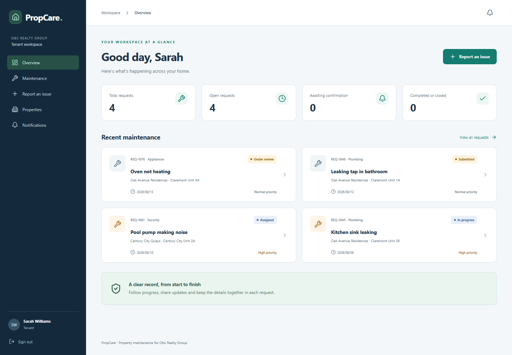
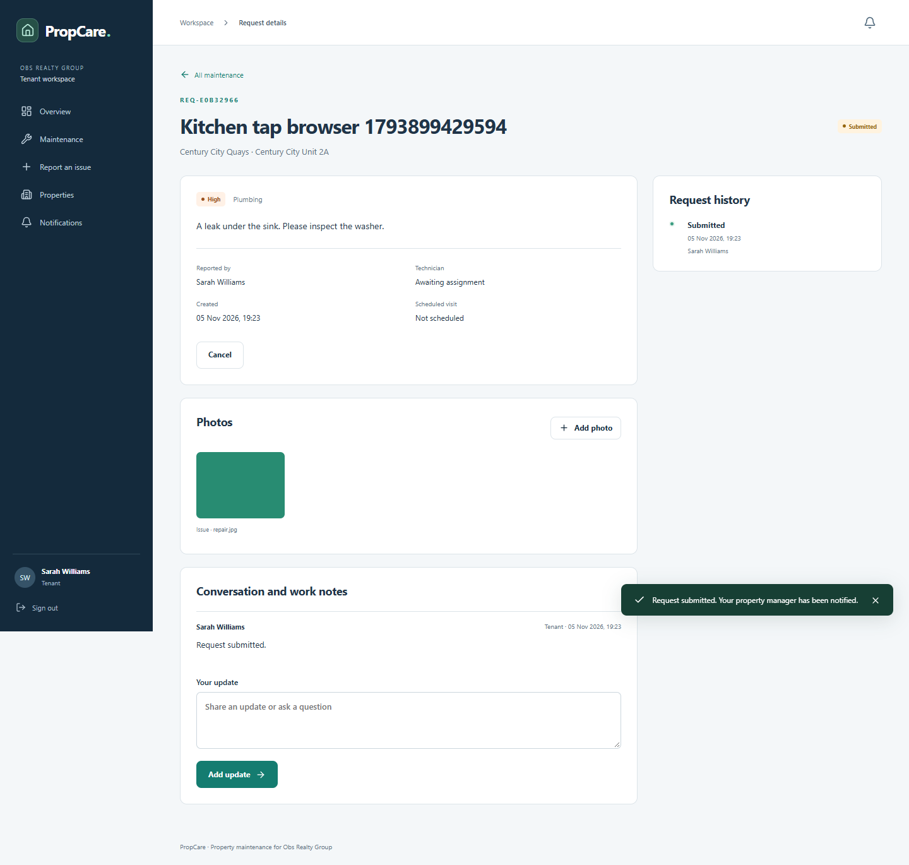
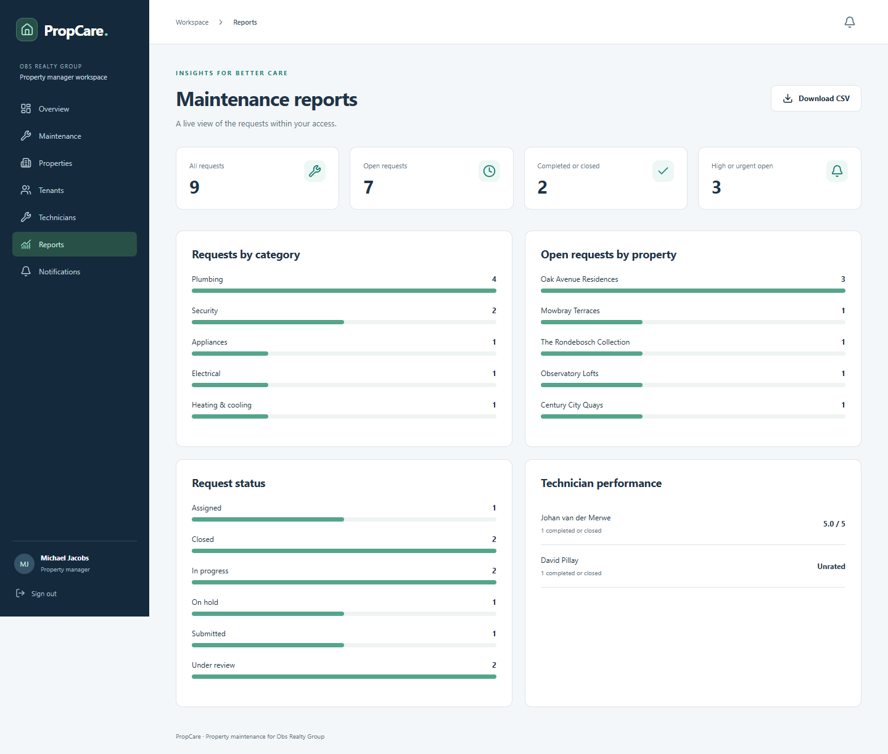
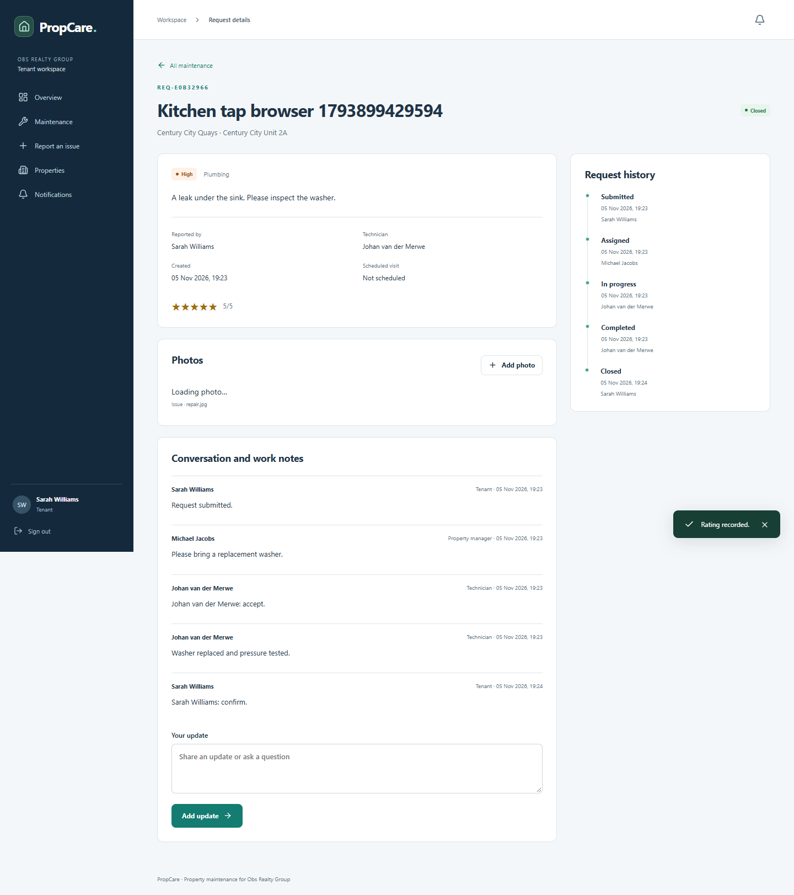
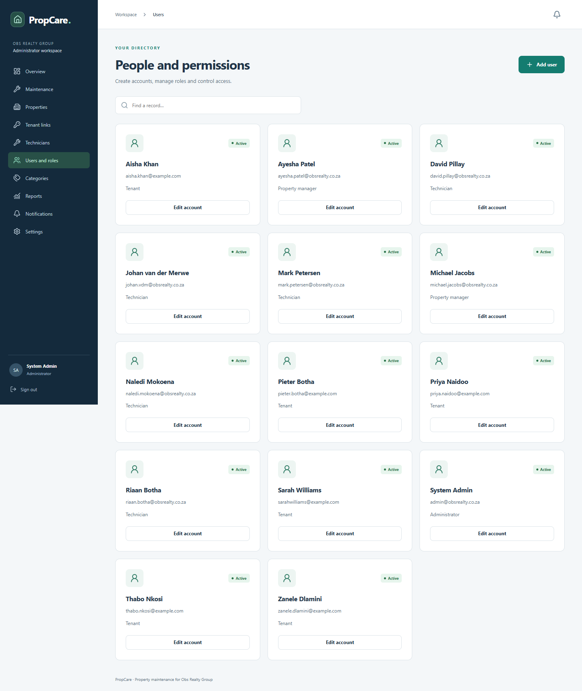

# PropCare user guide

PropCare helps tenants report maintenance issues, managers assign work, technicians record repairs and administrators manage the workspace. Open the live application linked in the repository README using a current Chrome or Edge browser. A stable internet connection is required. Other browser/device combinations require separate verification.

## Sign in and navigate

1. Open PropCare and enter the email and password assigned to you. Demonstration passwords are shared privately, not published in the guide.
2. After signing in, use the sidebar to open the pages available to your role. On a narrow screen, open the navigation button in the top bar.
3. Select the notification bell to read updates. Show unread only filters new updates; Mark as read changes one notification, while Mark all read changes your account's unread updates. Open your profile from the account area to update your name, email or password.
4. Use Sign out when finished, especially on a shared computer. If sign-out fails, check the connection and try again.

Keyboard users can Tab to Skip to main content, move through links and fields, and press Enter to activate controls. Escape closes a dialog and returns focus to its trigger.

Open Help in the sidebar for the guide tailored to your current role, direct links to the relevant pages and expandable answers about photos, account access and request actions.

## Tenant

1. If you do not have an account, choose registration on the sign-in screen. Registration creates a tenant account; an administrator must verify and link your property/unit before you can report an issue.
2. Select Report an issue. Choose your linked unit and category, enter a clear title and description and choose urgency. Attach a JPEG, PNG or WebP photo when useful. Each photo must be no larger than 5 MB; a request can contain up to ten photos.
3. Submit the form once. If a photo fails after the request is saved, retry the upload from the displayed request rather than submitting a second request.
4. Open Maintenance to search/filter your requests. Select a request to read its status, history, comments and photos. Add comments to supply further information.
5. When work is completed, inspect the repair. Confirm resolution to close the request, or reopen it with an explanation if further work is needed. Rate completed work from one to five stars; each request permits one rating.
6. Read in-app notifications for changes. Email copies are sent only when the workspace has enabled SMTP delivery.

## Property manager

1. Open Maintenance to review requests within your managed properties. Use search and status filters to locate work.
2. Open a request, review its details and select the appropriate available action. Assign an active technician, set urgency and optionally schedule a future visit and add a note.
3. Monitor the technician's progress and history. Use comments for clarification. Available actions change with the current status.
4. Review completed work and approve closure where appropriate. View Properties, Tenants and Technicians to inspect the records within your permitted scope.
5. Open Reports for current aggregates and use the CSV export control when needed.

## Technician

1. Open Maintenance to view jobs assigned to you. Open a job and accept it, or reject the assignment when appropriate.
2. Use My schedule to view dated visits. Record progress, notes and before/after photos on the request.
3. Place work on hold when necessary and resume it when ready. Mark it complete only after recording the repair details.
4. The tenant can confirm or reopen completed work, and the manager can approve it. Read notifications and history to follow the handover.

## Administrator

1. Open Users and roles to create or update accounts. Select the correct role and active state. Password resets and deactivation revoke existing sessions.
2. Create a property linked to its manager, then use Tenant links to connect the verified tenant, property and unit. A registered tenant cannot report maintenance until that relationship exists.
3. Maintain categories and technician records. Archive records through the provided controls; referenced maintenance history is retained.
4. Open Settings to update the organisation name. When email is enabled, this page displays queued and exhausted deliveries and provides Retry failed emails.
5. Configure SMTP and hosting through the deployment service as described in DEPLOYMENT.md. Application settings never display provider passwords.

## Troubleshooting

| Situation | Action |
| --- | --- |
| Application initially takes time to open | The current free hosting instance may be asleep. Allow it to wake, then retry. An always-on upgrade is a separate hosting decision. |
| No assigned unit appears | Ask the administrator to verify your tenancy and link the active property/unit. |
| Action is missing or rejected | Check the current role/status and refresh. Another participant may have updated the request. |
| Photo rejected | Use an actual JPEG, PNG or WebP under 5 MB. A renamed unsupported file is still rejected. |
| Session expired or account locked | Sign in again; repeated failed attempts can temporarily lock the account. Contact an administrator for an account/password reset. |
| Email not received | Check in-app notifications. The administrator should confirm SMTP is enabled and inspect queued/failed deliveries. |
| Record changed or duplicate error | Refresh before retrying, and confirm that the record was not already saved. |
| Connection or sign-out failure | Restore connectivity and retry the action. Do not assume that a failed sign-out ended the session. |

Screenshots were captured from the tested application using fictional records. They illustrate controls; names and request counts will change as the workspace is used.
